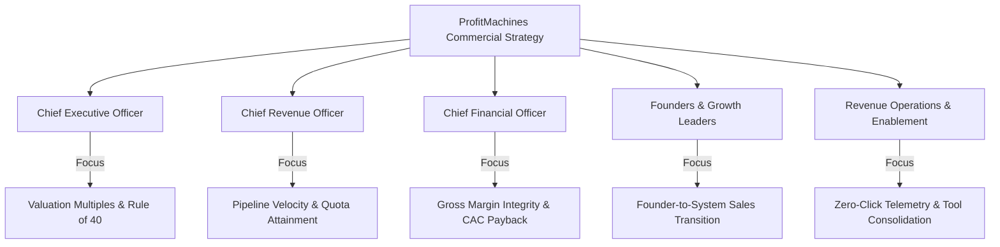
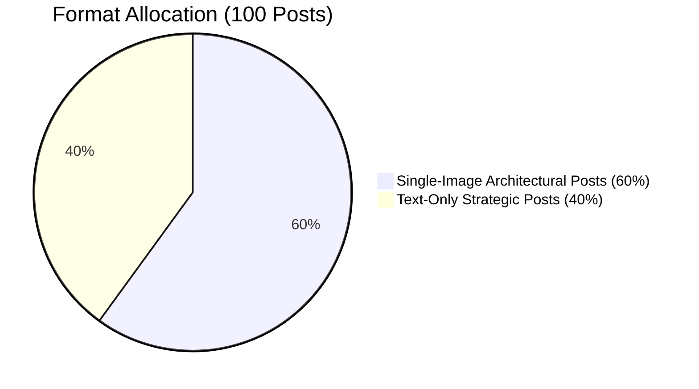

# ProfitMachines — Enterprise LinkedIn Content Strategy & Publishing Playbook

## 1. Executive Summary & Core Positioning

This document establishes the strategic foundation, publishing cadence, and operational execution playbook for the **ProfitMachines 100-Post LinkedIn Content Library**.

### The Core Business Thesis
**ProfitMachines.work is not about generic AI automation.** 
It is about engineering three measurable commercial outcomes:
1. **Revenue Acceleration:** Revealing hidden profit pools, unearthing underserved market whitespace, capturing dark-funnel buying signals, and driving qualified enterprise demand.
2. **Sales Acceleration:** Liberating frontline account executives from administrative friction (CRM data entry, manual research, fragmented tools) through autonomous 360° dossiers, real-time in-flight deal guidance, and rapid proposal generation.
3. **Margin Expansion:** Eliminating casual discounting, stopping post-sale custom delivery scope creep, and automating customer onboarding to keep gross margins compounding above 85%.

Supported by a foundation of **Enterprise Trust & Governance**: SOC2 Type II compliance, continuous contact self-healing, and mandatory human-in-the-loop oversight.

---

## 2. Audience Segmentation & Decision-Maker Personas

The content library addresses five primary executive stakeholders across enterprise B2B organizations ($10M to $250M+ ARR):

### Persona Matrix & Messaging Pillars
| Stakeholder | Strategic Priority | Primary Pain Point | ProfitMachines Solution |
| :--- | :--- | :--- | :--- |
| **Chief Executive Officer (CEO)** | Enterprise valuation multiple & capital efficiency | Unpredictable quarterly forecasts & linear headcount traps | Integrated AI-Native revenue architecture; Rule of 40 acceleration |
| **Chief Revenue Officer (CRO)** | Quota attainment & sales capacity utilization | Low rep selling time (35%) & late-stage deal slippage | Autonomous 360° dossiers & in-flight deal guidance co-pilots |
| **Chief Financial Officer (CFO)** | Gross margin preservation & CAC payback velocity | Casual 20%+ price discounting & bloated GTM tech stacks | Deal desk governance, stack consolidation & fully loaded CAC tracking |
| **Founders & Growth Leaders** | Transitioning from founder hustle to repeatable scale | Founder calendar choked on closing calls; rep ramp lags | Codified sales playbooks & autonomous qualification engines |
| **RevOps & Enablement Directors** | Clean CRM telemetry & pipeline predictability | Data decay (30%/yr), broken handoffs & dashboard paralysis | Zero-click CRM sync, stage dwell alerts & unified lifecycle spine |

---

## 3. The 100-Topic Content Library Architecture

The library is organized across 12 distinct categories covering the entire commercial lifecycle:

```mermaid
graph LR
    subgraph Foundation ["Demand & Discovery (Topics 01–20)"]
        PA["Pipeline Acceleration (01–10)"]
        CO["Conversion Optimization (11–20)"]
    end
    subgraph Acceleration ["Execution & Efficiency (Topics 21–40)"]
        AST["AI-Augmented Sales Teams (21–30)"]
        RTE["Revenue Team Efficiency (31–40)"]
    end
    subgraph Economics ["Financial Governance (Topics 41–60)"]
        GMI["Gross Margin Improvement (41–50)"]
        COPT["Cost Optimization (51–60)"]
    end
    subgraph Intelligence ["Systems & AI (Topics 61–80)"]
        RI["Revenue Intelligence (61–70)"]
        ASE["AI Sales Execution (71–80)"]
    end
    subgraph Leadership ["Executive C-Suite (Topics 81–100)"]
        CEOP["CEO Perspectives (81–85)"]
        CROP["CRO Perspectives (86–90)"]
        CFOP["CFO Perspectives (91–95)"]
        FNDR["Founders & Leaders (96–100)"]
    end

    Foundation --> Acceleration --> Economics --> Intelligence --> Leadership
```

### Category Breakdown
1. **Pipeline Acceleration (Topics 01–10):** Uncovering hidden demand, ICP precision, reducing lead response latency, signal triangulation, and pipeline quality over volume.
2. **Conversion Optimization (Topics 11–20):** Diagnosing stage losses, consultative discovery, the Problem-to-Value bridge, friction reduction, and proposal architecture.
3. **AI-Augmented Sales Teams (Topics 21–30):** Liberating reps from admin work, human-in-the-loop division of labor, 360° pre-meeting dossiers, and daily operating rhythms.
4. **Revenue Team Efficiency (Topics 31–40):** Handoff audits, CRM self-healing data loops, metric rationalization, tech stack consolidation, and 90-day rep ramp curves.
5. **Gross Margin Improvement (Topics 41–50):** The mathematics of discounting, customer profitability tiers, SOW scope creep, Cost-to-Serve audits, and deal desk governance.
6. **Cost Optimization (Topics 51–60):** Fully loaded CAC decomposition, eliminating GTM redundancy, channel payback velocity, and self-serve vs assisted routing.
7. **Revenue Intelligence (Topics 61–70):** Leading vs lagging telemetry, stage velocity equations, account engagement scoring, win-rate power alleys, and deal slippage triage.
8. **AI Sales Execution (Topics 71–80):** 60-second autonomous research, in-flight battlecard guidance, adaptive follow-up sequencing, and proposal generation.
9. **CEO Perspectives (Topics 81–85):** Predictability as valuation multiple, C-suite revenue alignment, the Golden Triangle of growth, and board scorecards.
10. **CRO Perspectives (Topics 86–90):** Why revenue engines break at scale, modern commercial org charts, and ending quarterly closing panic.
11. **CFO Perspectives (Topics 91–95):** Revenue quality over speed, SaaS tech stack rationalization, and empirical forecast stress-testing.
12. **Founders & Growth Leaders (Topics 96–100):** Moving from founder-led to system-led sales, Theory of Constraints triage, and the master AI-native revenue operating model.

---

## 4. Format Distribution & Visual Creative System

### Distribution Strategy
The library contains **exactly 100 individual posts**:
- **40 Text-Only Strategic Posts:** Designed for provocative contrarian viewpoints, executive reflections, diagnostic teardowns, and leadership philosophies.
- **60 Single-Image Architectural Posts:** Designed for frameworks, comparison scorecards, process roadmaps, 4-quadrant matrices, and financial waterfalls.

### Visual Identity System (1200 × 1200px PNG)
Every graphic in `assets/post-images/` is rendered to institutional standards:
- **Canvas:** 1200 × 1200px square, high-contrast crisp rendering.
- **Background:** Clean off-white canvas (`#F8FAFC` to `#FFFFFF`) with subtle outer drop shadow.
- **Primary Typography:** Deep corporate navy (`#0F172A`, `#1E293B`) for maximum readability on mobile feeds.
- **Accent Hierarchy:** Brilliant electric blue (`#2563EB`, `#1D4ED8`) for primary frameworks; Emerald green (`#10B981`, `#059669`) for positive outcomes and margin indicators; Crimson (`#BE123C`, `#EF4444`) for operational risk warnings.
- **Branding:** Discrete, authoritative `PROFITMACHINES` top pill badge and `profitmachines.work` outcome banner on every creative.

---

## 5. Publishing Cadence & Schedule (20-Week Master Roadmap)

To maximize engagement and algorithm distribution, posts are scheduled across a **5-day weekly cadence** (1 post per day, 5 posts per week, completing 100 posts over 20 consecutive weeks):

| Day of Week | Content Focus | Target Persona | Format Preference |
| :--- | :--- | :--- | :--- |
| **Monday** | Strategic Diagnosis / Market Whitespace | CEO / CRO / Founders | Single-Image Framework |
| **Tuesday** | Commercial Methodology / Sales Execution | VPs of Sales / Reps | Text-Only Opinion / Teardown |
| **Wednesday** | Operational Systems / RevOps Telemetry | RevOps / Enablement | Single-Image Architecture |
| **Thursday** | Unit Economics & Pricing / Deal Desk | CFO / Commercial Finance | Single-Image Matrix / Waterfall |
| **Friday** | Executive Perspective / Weekly Takeaway | C-Suite / Founders | Text-Only Strategic Reflection |

### Suggested Daily Posting Times (Target Timezones: EST / PST)
- **Morning Slot (Optimal):** 07:45 AM – 08:30 AM EST (Captures executive morning reading routine)
- **Mid-Day Alternative:** 11:45 AM – 12:30 PM EST (Captures lunch desk review)

---

## 6. Copywriting & Narrative Architecture

Every post in the library follows an executive-grade, non-salesy commercial structure:

1. **The Pattern-Interrupt Hook:** A bold, counter-intuitive opening statement that exposes a common industry misconception (e.g., *"More pipeline does not equal more revenue"* or *"A 15% discount destroys 50% of operating profit"*).
2. **The Commercial Tension:** Unpacking why the status quo fails, citing operational and financial friction.
3. **The Concrete Insight / Framework:** Introducing a named, structured methodology (e.g., *The Lead Response Decay Curve*, *The Problem-to-Value Bridge*).
4. **Actionable Takeaway:** Providing 3 to 4 specific operational rules or diagnostic questions.
5. **Natural Commercial CTA:** A low-friction invitation to explore verified offerings at `profitmachines.work`.
6. **Hashtag Selection:** 3 to 5 targeted B2B hashtags (`#RevenueAcceleration`, `#RevOps`, `#EnterpriseSales`, `#CFO`).

---

## 7. Engagement & Social Lead-Nurturing Playbook

To convert LinkedIn engagement into inbound executive pipeline:

### 1. First 60 Minutes (Algorithm Momentum)
- When a post is published, ensure 2–3 company executives leave substantive, value-adding comments within 45 minutes to trigger the LinkedIn distribution algorithm.

### 2. Comment Section Stewardship
- Reply to every thoughtful executive comment within 4 hours.
- Never answer with simple generic praise ("Thanks for reading!"). Add secondary business context: *"Completely agree, David. In our enterprise audits, we frequently find that CFO involvement is delayed until Day 60, making that objection almost inevitable."*

### 3. Direct Message Conversion Pathway
- When an executive likes or comments on an architectural post:
  - **Do NOT pitch immediately.**
  - Send a peer-to-peer message: *"Hi [Name], noticed your comment on the Cost-to-Serve framework. Curious if your team has seen similar margin drag in multi-year enterprise contracts this year?"*
  - Transition the conversation to an executive consultation only when mutual commercial interest is established.

